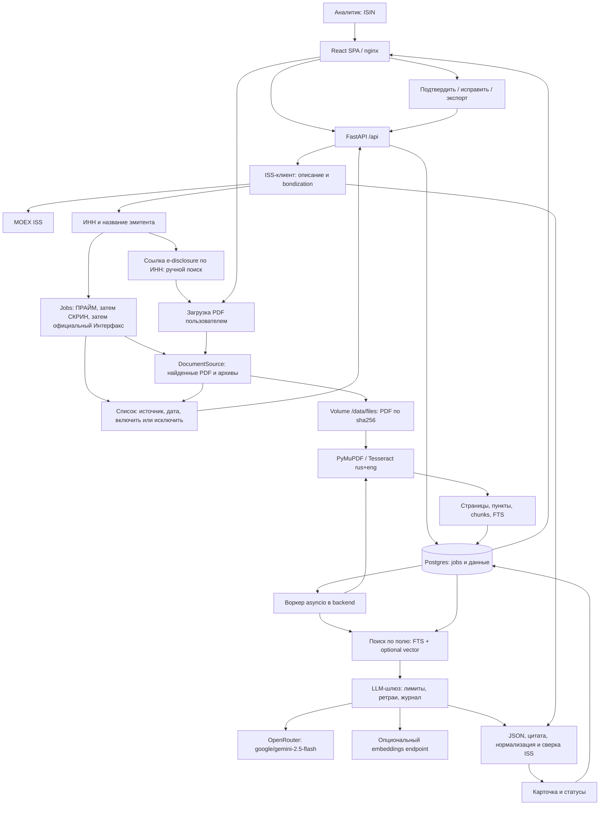

# Архитектура MVP «Карточка облигации»

## Назначение и состояние

Система помогает аналитику долгового рынка, инвестсоветнику и андеррайтеру проверить условия корпоративного выпуска (приоритет — ВДО). Вход: ISIN, автосбор документов и всегда доступная загрузка PDF пользователем. До извлечения пользователь выбирает найденные документы. Выход: шапка выпуска, 15 полей с источниками, флаги расхождений и журнал обработки. Текст интерфейса: «Факты из документов эмитента, не инвестиционная рекомендация».

Этап 2 реализован: Alembic/модели, ISS/нормализация, коллекторы, PDF/OCR, индекс, jobs и API документов. Ниже общий проект MVP, включая ещё не реализованное LLM-извлечение/карточки этапа 3 и UI этапа 4. Текущий POST карточки синхронный, совместимый с фронтом; 16 прежних полей not_found с причиной extraction_pending_stage3. not_implemented удалён из кода и тестов по уточнению этапа 2.

Приоритет решений: уточнение этапа 1b → мастер-задание MVP → эти документы → [исходная анкета](contest/answers_4-8.md). Отличия от анкеты и подтверждённость внешних источников зафиксированы в [DATA.md](DATA.md). Контракт полей — [CARD_FIELDS.md](CARD_FIELDS.md), HTTP — [API.md](API.md), план — [DEVELOPMENT.md](DEVELOPMENT.md).

## Границы

В MVP: ISS → ИНН → последовательный автосбор ПРАЙМ, СКРИН, Интерфакс при официальном доступе; ассистированный поиск e-disclosure и загрузка PDF; PyMuPDF/Tesseract rus+eng, FTS с опциональными эмбеддингами, OpenRouter, проверки, правки, Markdown, журнал и оценка качества. Автосбор — ключевая часть MVP, но не гарантия полного комплекта документов.

Вне MVP: обход антибота/капчи e-disclosure, AK&M (по ограничениям robots из задания), DOC/HTML-парсинг, Telegram-бот, сбор сущфактов из Telegram-канала Интерфакса, PDF-экспорт, скоринг, рекомендации, рассылки, постоянный мониторинг, календарь и рейтинги. Работа без ключа LLM обязательна; отсутствие/ошибка эмбеддингов не блокирует FTS.

## Компоненты и поток

| Компонент | Ответственность |
|---|---|
| ISS-клиент | ISIN → secid, описание, все страницы bondization, снимок ответа и время получения; без LLM |
| `DocumentSource` | Общий интерфейс обнаружения/скачивания документов и provenance; Upload, Prime, Skrin, EDisclosure; контракт в DATA |
| `PrimeSource` / `SkrinSource` | Найти эмитента по ИНН/названию и документы выпуска, скачать PDF/архивы с соблюдением robots; структуры подтверждены живыми ответами/fixtures, детали и ограничения в DATA |
| `EDisclosureSource` | Только официальный договорной API, env EDISCLOSURE_API_URL/KEY; сейчас заглушка «нужен официальный доступ», без пары env выключен; ассистированная ссылка доступна независимо |
| Ingest | Проверка PDF, потоковый лимит, sha256, сохранение файла и записи документа |
| Parser / indexer | Текст каждой страницы, OCR при отсутствии текста, пункт, chunks, FTS, необязательный vector |
| Retriever | Поисковые подсказки поля, фильтр выпуска и снимка документов, подбор контекста с источниками |
| LLM gateway | Все обращения к генерации и эмбеддингам, бюджет, таймауты, ретраи, структурированный ответ и журнал |
| Extractor | Промпт поля на русском, Pydantic-валидация, никаких рекомендаций и домысливания |
| Verifier | Подтверждение цитат и сравнение с ISS; статусы определяют правила |
| Card service | Версия карточки, правки пользователя, экспорт и журнал |

## Пайплайн

1. Нормализовать ISIN (trim, uppercase); текущий каркас проверяет только `RU` + 9 букв/цифр + цифру, без контрольной суммы. Получить ISS/secid/эмитента/ИНН. ИНН: `description.EMITTER_ID` → `/iss/emitters/{id}.json` (поля `INN`, `OGRN`, `URL`, `TITLE`); запасной путь — `/iss/securities.json?q={isin}` (колонка `emitent_inn`). Проверено 15.11.2026. Нет ИНН → поиск по названию с ручной проверкой совпадения; не выдумывать идентификатор.
2. Создать collect-job: ПРАЙМ → СКРИН → e-disclosure только при официальном доступе. Каждый источник даёт собственный статус; ошибка одного не останавливает остальные и загрузку. Дедупликация PDF по sha256 с сохранением всех источников, robots/задержки/кэш — DATA. Показать список с датами и происхождением, ссылку ручного поиска e-disclosure; пользователь исключает лишние/добавляет PDF. Все PDF идут в общий ingest: проверка сигнатуры/открытия, 30 МиБ, `/data/files/<sha256>.pdf`. Архивы распаковываются безопасно и ограниченно, правила в OPERATIONS. Исходное имя не используется как путь.
3. Создать ingest-job. Для каждой физической страницы извлечь текст PyMuPDF; если текстового слоя нет — Tesseract rus+eng, `ocr=true`. Номер страницы 1-based, не печатный номер. Ошибки разбора и пустой результат OCR видны пользователю.
4. Нарезать по страницам и распознанным пунктам (`9.5.1.` и сходная нумерация). Не терять исходный текст. Пункт неизвестен → `clause=null`. Размер/перекрытие chunks подобрать на выборке; не считать нумерацию документа всегда одинаковой.
5. Построить `tsvector` с конфигурацией `russian` и GIN-индекс. Если embedding endpoint настроен — получить векторы через шлюз; размерность должна совпадать с `EMBEDDING_DIM`. Ошибка эмбеддингов → FTS и предупреждение. Тип и параметры vector-индекса проверить на фактической размерности и версии pgvector; не обещать поддержку произвольной размерности.
6. При сборке зафиксировать только включённые пользователем готовые документы, их хеши/provenance/даты, снимок ISS, версии схемы/промптов и настройки модели. Для каждого из 15 полей выбрать контекст только из этого набора. При наличии векторов объединить FTS/vector ранги; алгоритм слияния и top-k подобрать на dev-выборке.
7. LLM выдаёт `value`, `quote`, `document_id`, `page`, `clause`, `confidence`, `not_found`. Для составного значения нужны доказательства всех элементов; основной источник и дополнительные `evidence` описаны в API. Ссылки на другие пункты требуют извлечения этих пунктов, а не восстановления по памяти модели.
8. Проверить JSON, цитаты, затем нормализовать и сравнить поля 1–8 с ISS. Рассчитать итоговый статус каждого поля. Карточка может быть готова с `needs_review`, это не ошибка всей job.
9. Сохранить карточку и журнал: документы/страницы/OCR, модель, токены, расходы, время и ошибки. Человек подтверждает или исправляет поле, не затирая результат извлечения.

Автосбор возвращает collect-job с результатами по источникам, загрузка — ingest-job. Сборка допускается после завершения автосбора и готовности включённых документов; исключённый ошибочный PDF не блокирует её. При отсутствии PDF разрешена ISS-only карточка с явным предупреждением. Изменение выбора, новый сбор/загрузка не меняют старые карточки; повторная сборка создаёт новую версию. Состояния источника и парсинга — разные сущности, см. API.

### Jobs и восстановление

Один процесс Uvicorn в MVP запускает asyncio-worker через lifespan. Захват job — короткая транзакция `SELECT ... FOR UPDATE SKIP LOCKED`, запись `running` и commit; сетевые вызовы/OCR выполняются вне блокировки. Состояния: `queued → running → succeeded | failed`; `step`, `progress`, время и ошибка доступны по API. Процент 0–100 отражает завершённые шаги/поля, а не оценку оставшегося времени.

Предлагаемый механизм восстановления: lease/heartbeat, счётчик попыток и повтор просроченных job после рестарта. Шаги идемпотентны по job/document/field, иначе повтор создаст дубли и повторные расходы. OCR и синхронный SQL не блокируют event loop: отдельный thread/subprocess с таймаутом. Несколько реплик потребуют общей дисциплины бюджета и lease; отдельного сервиса очереди в MVP нет.

## Хранилища и схема БД

SQLAlchemy 2 + psycopg, Postgres `pgvector/pgvector:pg16`. Alembic создаёт таблицы, расширение vector и индексы; `alembic upgrade head` выполняется перед стартом backend. Это и файловый volume реализованы на этапе 2; online-применение миграции требует PostgreSQL и проверяется DB-тестами/CI.

| Таблица | Основные поля и связи |
|---|---|
| `issues` | `id`, `isin UNIQUE`, `secid`, ISS JSONB, `iss_updated_at` |
| `documents` | `id`, `issue_id FK`, тип, имя, sha256, страницы, path, parse status/error, `enabled`, created_at; UNIQUE(issue_id, sha256) |
| `document_origins` (уточнение 1b) | document FK, source (`prime/skrin/edisclosure/upload`), issuer/source URL, download URL, published_at nullable, fetched_at, архив URL/hash/entry nullable; несколько происхождений одного PDF |
| `pages` | `id`, `document_id FK`, `number`, `text`, `ocr`; UNIQUE(document_id, number) |
| `chunks` | `id`, document/page FK, `clause`, текст, tsvector, nullable vector(DIM), embedding model/version; GIN по FTS |
| `cards` | `id`, issue FK, status (`processing/ready/failed`), version, created/updated; UNIQUE(issue_id, version) |
| `card_fields` | `id`, card FK, code, value JSONB, quote, document FK, page, clause, status, iss_value JSONB, confidence, user_status, user_value JSONB; UNIQUE(card_id, code) |
| `jobs` | `id`, type (`collect/ingest/build_card`), payload/result JSONB с состояниями источников, status, step, progress, error, времена; attempts, heartbeat/lease |
| `llm_calls` | `id`, job/field FK, purpose, model, tokens in/out, cost USD, cost_source, usage JSONB, provider response ID, duration/error/time; запись на попытку |

Для воспроизводимости предлагаются `cards.input_snapshot` JSONB (ID/sha256 документов, копия ISS, модель, версии) и `card_fields.evidence` JSONB для дополнительных цитат. Столбцы созданы миграцией этапа 2; их заполнение при сборке карточки — этап 3. В evidence проверяется принадлежность страницы документу и документа снимку карточки. Правки в MVP — последний `user_status/user_value` с временем; неизменяемый аудит всех редакций — отдельное развитие.

PDF хранятся только в volume, не в БД. Резервная копия должна включать согласованные БД и файлы; без файлов ссылка на источник невосстановима. Срок хранения/очистки и квоты диска — проверить и согласовать перед внешним демо.

## Шлюз и модели

`app/llm/gateway.py` — будущая единственная точка вызова; `client.py` — транспорт. Конфигурация через pydantic-settings/окружение, переменные в README. Решение 1b: **OpenRouter**, defaults `LLM_BASE_URL=https://openrouter.ai/api/v1`, `LLM_MODEL=google/gemini-2.5-flash`; ключ в Environment Backend Dokploy. В текущем коде defaults ещё пусты. Для OpenRouter заголовки `HTTP-Referer` из PUBLIC_BASE_URL и `X-Title: Bond Card MVP` (атрибуция необязательна); детали настройки в OPERATIONS. Поддержку `/embeddings` выбранной моделью OpenRouter проверить; отсутствие/ошибка → FTS. Кандидаты из анкеты остаются историческими альтернативами, не выбранной конфигурацией.

Генерация: сначала `response_format={"type":"json_schema",...}`, при явно неподдерживаемом режиме — `json_object` с той же Pydantic-валидацией. При невалидном JSON допускается один повтор. 429/5xx повторяются с ограниченным backoff и учётом Retry-After; предел попыток и таймауты задаются конфигом. Ошибки авторизации и бизнес-валидации бесконечно не повторять.

Дневной бюджет LLM_DAILY_BUDGET_USD — UTC. Токены брать из usage; валидное `usage.cost` OpenRouter приоритетно (включая 0), иначе `(tokens_in * price_in + tokens_out * price_out) / 1_000_000`. Хранить источник стоимости, raw usage, ID ответа. Не складывать два способа расчёта. До вызова транзакционно резервировать верхнюю оценку по тарифам/max tokens, затем уточнять по ответу. Тариф эмбеддингов отдельный; неизвестный usage/cost = null, резерв сохраняется до сверки. Платный вызов без достоверной верхней оценки не запускать. Ошибки/повторы также журналируются. Источники формата и атрибуции — [OPERATIONS](OPERATIONS.md).

Нет LLM-ключа → поля 1–8 из доступного ISS, `extracted`, источник `moex_iss`, без выдуманной PDF-цитаты; поля 9–15 → `not_found`, reason `llm_not_configured`. Нет данных ISS → `not_found`. Исчерпание бюджета/таймаут настроенной LLM → `needs_review` с причиной, не «условие отсутствует». Шапка ISS не требует LLM. Нет embedding-конфига → только FTS.

## Проверки и статусы

Порядок: схема → источник → цитата → полнота/неоднозначность → ISS. Нормализация цитаты: Unicode, регистр, кавычки, пробелы, переносы/перенос слова. Оригинал сохраняется. Сначала точное вхождение нормализованной цитаты в указанную страницу, затем ограниченный fuzzy-поиск. Метрика, минимальная длина и порог (проектная отправная точка 0.95) подбираются на размеченной выборке; изменения чисел, дат, отрицаний и исключений нельзя принимать лишь по высокой близости текста.

| Машинный статус | Условие и показ |
|---|---|
| `verified_iss` | Есть подтверждённая PDF-цитата и полное совпадение сопоставимых параметров с ISS |
| `mismatch_iss` | Цитата подтверждена, нормализованные параметры расходятся; показываем оба значения и флаг, не выбираем LLM как истину |
| `extracted` | Цитата подтверждена, сверять не с чем; либо явно отмеченный ISS-only источник |
| `not_found` | Не найдено в переданном корпусе либо LLM не настроена; причина обязательна, это не доказательство отсутствия условия |
| `needs_review` | Цитата не подтверждена, низкая уверенность, неполный график, неоднозначная версия, ошибка обработки или сравнения |

Неподтверждённое LLM-значение не выдаётся как факт: публичное `value=null`, reason `quote_not_verified`. ISS-значение при наличии остаётся отдельно. `confidence` — самооценка модели, не вероятность истинности; порог подобрать и закрепить перед оценкой. Неполное совпадение графика не даёт `verified_iss`. Если ISS отсутствует, документ с хорошей цитатой даёт `extracted` с предупреждением об ISS.

Пользовательские `confirmed/corrected` хранятся отдельно в `user_status`. При `corrected` задаётся новое типизированное `user_value`; исходные value/status/quote не меняются. UI и экспорт выделяют правку и машинный результат. Исправление не превращает неподтверждённую цитату в подтверждённую и не исключает исходную ошибку из оценки.

## API и фронтенд

Целевой HTTP-контракт в [API.md](API.md): документы/issues/jobs, асинхронная сборка, карточки/правки/экспорт, защищённый технический журнал. Текущий `POST /api/cards` (200 с заглушкой) сменится на 202 с ID задачи на этапе 3.

SPA: ISIN → шапка ISS/ИНН → автосбор и статусы источников → список с provenance/датами и включением/выключением → ассистированный e-disclosure или drag&drop PDF → сборка → polling job → две группы полей (8 + 7). Цитата раскрывается, источник: имя документа, физическая страница, пункт. Для графиков доступны все элементы и их доказательства. Цвет бейджа дополняется текстом. При расхождении — оба значения, при ошибке — понятная причина и возможность повторной сборки. Кнопки подтверждения/исправления, Markdown-экспорт, последние карточки, журнал и постоянный дисклеймер. Никаких внешних CDN; ресурсы под CSP `'self'`. UI не отображает сырой HTML из PDF/LLM.

## Деплой

Текущая топология Dokploy Dev/PROD, сети, alias, volumes, вебхуки, CI и хуки — в [OPERATIONS](OPERATIONS.md). Этап 2 добавил files-volume для каждого окружения, миграции перед Uvicorn, Tesseract rus+eng и лимит nginx; живую настройку Traefik ещё проверить; на этапе 3 — OpenRouter gateway и новые env из README. Этап 2 обновляет образы/Compose в репозитории; живой деплой не выполнялся.

## Наблюдаемость и безопасность

Логи связываются по `job_id/card_id/document_id/field_code`, содержат шаг, длительность и код ошибки. API/журнал показывают количество страниц/OCR, модель, токены, расходы (или неизвестность), время, предупреждения. Admin stats — расходы UTC-дня, бюджет, ошибки и состояния job; каждый retry виден отдельно. Ключи, ADMIN_TOKEN, полные промпты и PDF-тексты не должны попадать в обычные логи. `/api/health` сейчас проверяет БД, а `llm=configured` означает лишь наличие ключа, не успешный вызов провайдера.

PDF: ограничение размера при чтении потока, числа файлов/страниц и времени разбора; конкретные квоты кроме 30 МиБ уточнить при реализации. MIME недостаточно — проверять содержимое парсером. Не выполнять вложения/JavaScript, не использовать пользовательский путь, не отдавать абсолютный storage path клиенту. Текст документа — недоверенные данные: инструкции из него не могут менять системный промпт или вызывать инструменты. Выдача JSON ограничена схемой, статусы назначают правила.

Admin API: `X-Admin-Token`, `secrets.compare_digest`, при пустом ADMIN_TOKEN доступ закрыт. Остальной MVP API открыт; ограничения размеров загрузки реализованы; rate limits создания/collect/загрузки запланированы на этап 3. Это означает общий доступ к карточкам и правкам в демо: для конфиденциальных документов и многопользовательского запуска сначала нужны аутентификация/права и политика хранения. Rate limit не заменяет права доступа. Секреты задаются окружением, `.env*` на этапе 1 не меняются.

Продуктовое ограничение: только факты, без персонализации, shortlist-рекомендаций, прогнозов доходности и призывов купить/продать. Дисклеймер — часть UI и экспорта, но не юридическое заключение. Квалификацию результата как не-ИИР, условия использования ISS/раскрытия, передачи текстов LLM-провайдеру, хранения и удаления данных — проверить до внешнего запуска. Этап 1 не подтверждает регуляторное соответствие.

## Развитие

1. Завершение интеграции официального Интерфакса после получения договора/спецификации; мониторинг сущфактов из Telegram-канала Интерфакса (t.me/s/edisclosure) — только развитие. Базовый автосбор ПРАЙМ/СКРИН и ассистированный режим уже входят в целевой MVP.
2. Календарь событий из уже проверенных купонов/оферт/амортизации с актуальностью источника.
3. «Что изменилось»: сравнение версий документов с точными источниками до/после и проверкой человека.
4. Ранние сигналы ВДО: отдельный эксперимент с рейтингами/сущфактами; не превращать отсутствие раскрытия в факт ухудшения.
5. Фильтр ИИР перед любым AI-текстом для инвестора: правила, блокировка рискованных формулировок и ручная проверка; критерии и юридическую достаточность проверить отдельно.
