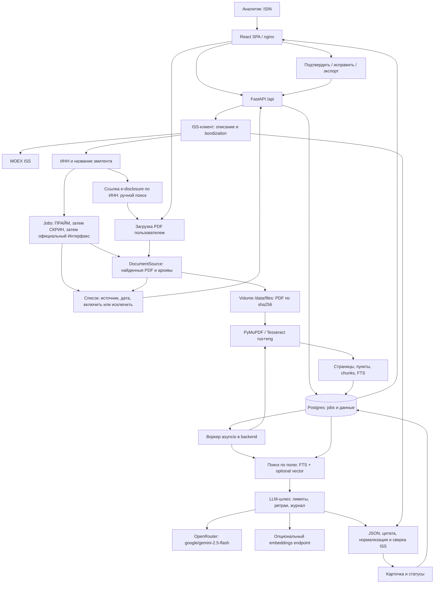

# Архитектура MVP «Карточка облигации»

## Назначение и состояние

Система помогает аналитику долгового рынка, инвестсоветнику и андеррайтеру проверить условия корпоративного выпуска (приоритет — ВДО). Вход: ISIN, автосбор документов и всегда доступная загрузка PDF пользователем. До извлечения пользователь выбирает найденные документы. Выход: шапка выпуска, 15 полей с источниками, флаги расхождений и журнал обработки. Текст интерфейса: «Факты из документов эмитента, не инвестиционная рекомендация».

Этапы 2–4 реализованы: данные/коллекторы/PDF, jobs, извлечение по схеме, цитаты/ISS, карточки/правки/экспорт/admin, бюджет и SPA. API карточки асинхронный: 202 с card_id/job_id. Инструментарий оценки этапа 5 реализован в backend/eval; качество модели на реальном корпусе ещё не подтверждено, см. EVALUATION.

Приоритет решений: уточнение этапа 1b → мастер-задание MVP → эти документы → [исходная анкета](contest/answers_4-8.md). Отличия от анкеты и подтверждённость внешних источников зафиксированы в [DATA.md](DATA.md). Контракт полей — [CARD_FIELDS.md](CARD_FIELDS.md), HTTP — [API.md](API.md), план — [DEVELOPMENT.md](DEVELOPMENT.md).

## Границы

В MVP: ISS → ИНН → последовательный автосбор ПРАЙМ, СКРИН, Интерфакс при официальном доступе; ассистированный поиск e-disclosure и загрузка PDF; PyMuPDF/Tesseract rus+eng, FTS с опциональными эмбеддингами, OpenRouter, проверки, правки, Markdown, журнал и оценка качества. Автосбор — ключевая часть MVP, но не гарантия полного комплекта документов.

Вне MVP: обход антибота/капчи e-disclosure, AK&M (по ограничениям robots из задания), DOC/HTML-парсинг, Telegram-бот, сбор сущфактов из Telegram-канала Интерфакса, PDF-экспорт, скоринг, рекомендации, рассылки, постоянный мониторинг, календарь и рейтинги. Работа без ключа LLM обязательна; отсутствие/ошибка эмбеддингов не блокирует FTS.

## Компоненты и поток

| Компонент | Ответственность |
|---|---|
| ISS-клиент | ISIN → secid, описание, все страницы bondization, снимок ответа и время получения; без LLM |
| `DocumentSource` | Общий интерфейс обнаружения/скачивания документов и provenance; Upload, Prime, Skrin, EDisclosure; контракт в DATA |
| `PrimeSource` / `SkrinSource` | Найти эмитента по ИНН/названию и документы выпуска, скачать PDF/архивы с соблюдением robots; структуры подтверждены живыми ответами/fixtures, детали и ограничения в DATA |
| `EDisclosureSource` | Только официальный договорной API, env EDISCLOSURE_API_URL/KEY; сейчас заглушка «нужен официальный доступ», без пары env выключен; ассистированная ссылка доступна независимо |
| Ingest | Проверка PDF, потоковый лимит, sha256, сохранение файла и записи документа |
| Parser / indexer | Текст каждой страницы, OCR при отсутствии текста, пункт, chunks, FTS, необязательный vector |
| Retriever | Поисковые подсказки поля, фильтр выпуска и снимка документов, подбор контекста с источниками |
| LLM gateway | Все обращения к генерации и эмбеддингам, бюджет, таймауты, ретраи, структурированный ответ и журнал |
| Extractor | Промпт поля на русском, Pydantic-валидация, никаких рекомендаций и домысливания |
| Verifier | Подтверждение цитат и сравнение с ISS; статусы определяют правила |
| Card service | Версия карточки, правки пользователя, экспорт и журнал |

## Пайплайн

1. Нормализовать ISIN (trim, uppercase); текущий каркас проверяет только `RU` + 9 букв/цифр + цифру, без контрольной суммы. Получить ISS/secid/эмитента/ИНН. ИНН: `description.EMITTER_ID` → `/iss/emitters/{id}.json` (поля `INN`, `OGRN`, `URL`, `TITLE`); запасной путь — `/iss/securities.json?q={isin}` (колонка `emitent_inn`). Проверено 15.11.2026. Нет ИНН → поиск по названию с ручной проверкой совпадения; не выдумывать идентификатор.
2. Создать collect-job: ПРАЙМ → СКРИН → e-disclosure только при официальном доступе. Каждый источник даёт собственный статус; ошибка одного не останавливает остальные и загрузку. Дедупликация PDF по sha256 с сохранением всех источников, robots/задержки/кэш — DATA. Показать список с датами и происхождением, ссылку ручного поиска e-disclosure; пользователь исключает лишние/добавляет PDF. Все PDF идут в общий ingest: проверка сигнатуры/открытия, 30 МиБ, `/data/files/<sha256>.pdf`. Архивы распаковываются безопасно и ограниченно, правила в OPERATIONS. Исходное имя не используется как путь.
3. Создать ingest-job. Для каждой физической страницы извлечь текст PyMuPDF; если текстового слоя нет — Tesseract rus+eng, `ocr=true`. Номер страницы 1-based, не печатный номер. Ошибки разбора и пустой результат OCR видны пользователю.
4. Нарезать по страницам и распознанным пунктам (`9.5.1.` и сходная нумерация). Не терять исходный текст. Пункт неизвестен → `clause=null`. Размер/перекрытие chunks подобрать на выборке; не считать нумерацию документа всегда одинаковой.
5. Построить `tsvector` с конфигурацией `russian` и GIN-индекс. Если embedding endpoint настроен — получить векторы через шлюз; размерность должна совпадать с `EMBEDDING_DIM`. Ошибка эмбеддингов → FTS и предупреждение. Тип и параметры vector-индекса проверить на фактической размерности и версии pgvector; не обещать поддержку произвольной размерности.
6. При сборке зафиксировать только включённые пользователем готовые документы, их хеши/provenance/даты, снимок ISS, версии схемы/промптов и настройки модели. Для двух пакетов полей выбрать контекст только из этого набора. При размере полного контекста до EXTRACTION_FULL_CONTEXT_MAX_TOKENS обе группы получают все страницы; большие комплекты используют групповой ретривер. При наличии векторов объединить FTS/vector ранги; алгоритм слияния и top-k подобрать на dev-выборке.
7. LLM выдаёт `value`, `quote`, `document_id`, `page`, `clause`, `confidence`, `not_found`. Для составного значения нужны доказательства всех элементов; основной источник и дополнительные `evidence` описаны в API. Ссылки на другие пункты требуют извлечения этих пунктов, а не восстановления по памяти модели.
8. Проверить JSON, цитаты, затем нормализовать и сравнить поля 1–8 с ISS. Рассчитать итоговый статус каждого поля. Карточка может быть готова с `needs_review`, это не ошибка всей job.
9. Сохранить карточку и журнал: документы/страницы/OCR, модель, токены, расходы, время и ошибки. Человек подтверждает или исправляет поле, не затирая результат извлечения.

Автосбор возвращает collect-job с результатами по источникам, загрузка — ingest-job. Сборка допускается после завершения автосбора и готовности включённых документов; исключённый ошибочный PDF не блокирует её. При отсутствии PDF разрешена ISS-only карточка с явным предупреждением. Изменение выбора, новый сбор/загрузка не меняют старые карточки; повторная сборка создаёт новую версию. Состояния источника и парсинга — разные сущности, см. API.

### Jobs и восстановление

Один процесс Uvicorn в MVP запускает asyncio-worker через lifespan. Захват job — короткая транзакция `SELECT ... FOR UPDATE SKIP LOCKED`, запись `running` и commit; сетевые вызовы/OCR выполняются вне блокировки. Состояния: `queued → running → succeeded | failed`; `step`, `progress`, время и ошибка доступны по API. Процент 0–100 отражает завершённые шаги/поля, а не оценку оставшегося времени.

Предлагаемый механизм восстановления: lease/heartbeat, счётчик попыток и повтор просроченных job после рестарта. Шаги идемпотентны по job/document/field, иначе повтор создаст дубли и повторные расходы. OCR и синхронный SQL не блокируют event loop: отдельный thread/subprocess с таймаутом. Бюджет/лимиты и lease общие через PostgreSQL, завершение/прогресс защищены владельцем job; отдельного сервиса очереди в MVP нет.

## Хранилища и схема БД

SQLAlchemy 2 + psycopg, Postgres `pgvector/pgvector:pg16`. Alembic создаёт таблицы, расширение vector и индексы; `alembic upgrade head` выполняется перед стартом backend. Это и файловый volume реализованы на этапе 2; online-применение миграции требует PostgreSQL и проверяется DB-тестами/CI.

| Таблица | Основные поля и связи |
|---|---|
| `issues` | `id`, `isin UNIQUE`, `secid`, ISS JSONB, `iss_updated_at` |
| `documents` | `id`, `issue_id FK`, тип, имя, sha256, страницы, path, parse status/error, `enabled`, created_at; UNIQUE(issue_id, sha256) |
| `document_origins` (уточнение 1b) | document FK, source (`prime/skrin/edisclosure/upload`), issuer/source URL, download URL, published_at nullable, fetched_at, архив URL/hash/entry nullable; несколько происхождений одного PDF |
| `pages` | `id`, `document_id FK`, `number`, `text`, `ocr`; UNIQUE(document_id, number) |
| `chunks` | `id`, document/page FK, `clause`, текст, tsvector, nullable vector(DIM), embedding model/version; GIN по FTS |
| `cards` | `id`, issue FK, status (`processing/ready/failed`), version, created/updated; UNIQUE(issue_id, version) |
| `card_fields` | `id`, card FK, code, value JSONB, quote, document FK, page, clause, status, iss_value JSONB, confidence, user_status, user_value JSONB; UNIQUE(card_id, code) |
| `jobs` | `id`, type (`collect/ingest/build_card`), payload/result JSONB с состояниями источников, status, step, progress, error, времена; attempts, heartbeat/lease |
| `llm_calls` | `id`, job/field FK, purpose, model, tokens in/out, cost USD, cost_source, usage JSONB, provider response ID, duration/error/time; запись на попытку |

Для воспроизводимости предлагаются `cards.input_snapshot` JSONB (ID/sha256 документов, копия ISS, модель, версии) и `card_fields.evidence` JSONB для дополнительных цитат. Столбцы созданы миграцией этапа 2; сборка этапа 3 заполняет их. В evidence проверяется принадлежность страницы документу и документа снимку карточки. Правки в MVP — последний `user_status/user_value` с временем; неизменяемый аудит всех редакций — отдельное развитие.

PDF хранятся только в volume, не в БД. Резервная копия должна включать согласованные БД и файлы; без файлов ссылка на источник невосстановима. Срок хранения/очистки и квоты диска — проверить и согласовать перед внешним демо.

## Шлюз и модели

`app/llm/gateway.py` — единственная точка вызова; `client.py` — транспорт. Конфигурация через pydantic-settings/окружение, переменные в README. Решение 1b: **OpenRouter**, defaults `LLM_BASE_URL=https://openrouter.ai/api/v1`, `LLM_MODEL=google/gemini-2.5-flash`; ключ в Environment Backend Dokploy. Defaults кода и Compose установлены. Для OpenRouter заголовки `HTTP-Referer` из PUBLIC_BASE_URL и `X-Title: Bond Card MVP` (атрибуция необязательна); детали настройки в OPERATIONS. Поддержку `/embeddings` выбранной моделью OpenRouter проверить; отсутствие/ошибка → FTS. Кандидаты из анкеты остаются историческими альтернативами, не выбранной конфигурацией.

Транспорт — синхронный HTTPX, общий для генерации и эмбеддингов. `LLM_PROXY_URL` задаёт только их HTTP/HTTPS/SOCKS5-прокси; `trust_env=False` исключает глобальные proxy-переменные. Серверный backend подключён к внешней сети `<BACKEND_ALIAS>-llm` и использует default `http://tinvest-llm-proxy:7890`. Отдельный mihomo получает SUBSCRIPTION_URL только в своём Environment, загружает узлы через proxy-provider и подключён только к LLM-сети своего окружения; с другими проектами и dokploy-network сеть не разделяется. Настройки TUN/DNS/controller выключены, прямого fallback при пустой группе нет. ISS использует отдельный прямой HTTPX-запрос с `trust_env=False`, коллекторы — прямое pinned-DNS HTTPS-соединение; VPN-маршрут для backend не устанавливается. Локальный/CI корневой Compose не зависит от внешней сети и прокси. При недоступном прокси, включая DNS-ошибку его alias, код `llm_proxy_error` проходит обычный budgeted retry и деградацию с сохранением ISS; тексты исключений транспорта не сохраняются. URL исключён из repr/сериализации Settings; health/admin stats отдают только `llm_proxy` и `llm_proxy_scheme`. Развёртывание отдельного сервиса — [OPERATIONS](OPERATIONS.md#llm-через-прокси).

Генерация: сначала `response_format={"type":"json_schema",...}`, `strict=true`, с отдельной `provider_schema(model)`. Она инлайнит локальные `$ref`/`$defs`, превращает nullable `anyOf[X,null]` в массив типов (например `type: ["string","null"]`), сохраняет структуру/enum и короткие описания до 160 символов. Из схемы провайдера удалены format, pattern, числовые границы, min/max длины строк и массивов, title/default. Объекты сохраняют required для всех свойств и additionalProperties=false. Для дат/UUID остаются короткие текстовые подсказки. Полная Pydantic-модель и её ограничения не меняются и проверяют каждый ответ; затем выполняются прежние проверки цитат/ISS. Это уменьшает сложность схем Gemini, но не подтверждает совместимость конкретного живого endpoint без запуска на нём.

Nullable-массив типов сверён с [Gemini JSON Schema](https://ai.google.dev/gemini-api/docs/structured-output) и [OpenAI strict schema](https://developers.openai.com/api/docs/guides/structured-outputs); формат запроса — с [OpenRouter structured outputs](https://openrouter.ai/docs/guides/features/structured-outputs). Поддержка зависит от endpoint. HTTP 400/422 с маркерами schema, too many states, response_format или structured переключает на `json_object` **один раз**, с упрощённой схемой в отдельном сообщении. Повторный отказ не запускает новый цикл смены формата и даёт llm_schema_rejected либо llm_request_rejected. При невалидном JSON/нарушении полной модели допускается один repair. 429/5xx и временные сетевые ошибки повторяются с ограниченным backoff и учётом Retry-After; авторизация/кредиты/обычный 400 повторов не вызывают.

Дневной бюджет LLM_DAILY_BUDGET_USD — UTC. Токены брать из usage; валидное `usage.cost` OpenRouter приоритетно (включая 0), иначе `(tokens_in * price_in + tokens_out * price_out) / 1_000_000`. Хранить источник стоимости, raw usage, ID ответа. Не складывать два способа расчёта. До вызова транзакционно резервировать верхнюю оценку по тарифам/max tokens, затем уточнять по ответу. Тариф эмбеддингов отдельный; неизвестный usage/cost = null, резерв сохраняется до сверки. Платный вызов без достоверной верхней оценки не запускать. Ошибки/повторы также журналируются. Источники формата и атрибуции — [OPERATIONS](OPERATIONS.md).

Ответ HTTP 4xx **без usage** считается отказом до генерации: cost_usd=0, cost_source=request_rejected, state=failed, reserved_usd=0. Это включает ошибки схемы, 401/402/403/404/413/422 и rate limit 429. Известные расходы из usage не обнуляются даже при 4xx; непустой usage без вычислимой стоимости остаётся unknown. Таймауты/обрывы и 5xx без стоимости сохраняют резерв. Ledger суммирует известный cost и резервы только строк с cost=null; request_rejected не расходует дневной лимит. Исторические unknown-записи до исправления автоматически не изменяются: старые HTTP 400 нужно отдельно сверить на стенде, не обнуляя реальные/неопределённые расходы массово.

В llm_calls.error сохраняются короткий русский code/message, http_status и безопасные openrouter_message/provider_name/provider_message/provider_status, извлечённые только из выбранных полей ответа и JSON metadata.raw.error. Сообщения ограничены 500 символами, имя провайдера — 80, статус — 64. Полный raw, тело запроса и документы не сохраняются: ключи sk-..., Bearer, известные credentials и URL редактируются; JSON/явные request-эхо удаляются, сообщения с обнаруженным повтором входного текста опускаются. На поле карточки/в Markdown — только короткая русская причина из общего словаря: llm_schema_rejected («Модель отклонила схему ответа»), llm_auth_error («Неверный ключ LLM»), llm_insufficient_credits («Нет кредитов на OpenRouter») и другие. SPA уже отображает reason_message от backend.

Settings разрешает отсутствующие/пустые тарифы по точному имени модели: для `google/gemini-2.5-flash` defaults `0.30`/`2.50` USD за 1 млн входных/выходных токенов. Проверить актуальность на [openrouter.ai/models](https://openrouter.ai/models). Явные env-тарифы имеют приоритет; для другой модели без обоих тарифов — `llm_prices_not_configured` до запроса. Compose сохраняет пустой маркер для разрешения в Settings, чтобы тариф Gemini не стал общим для всех моделей. Эта таблица используется для резервирования и fallback-расчёта, приоритет фактического `usage.cost` не меняется.

При недоступности LLM поля 1–8 заполняются из доступного ISS: `extracted`, источник `moex_iss`, без PDF-цитаты и `verified_iss`. Это относится к отсутствию ключа/тарифов и любому отказу шлюза: бюджет, таймаут, ошибка провайдера/клиента, исчерпание попыток валидации JSON. Нет данных ISS → `not_found`, reason `iss_unavailable`. Код отказа сохраняется в `journal.warnings`. Поля 9–15 без ключа → `not_found`, reason `llm_not_configured`; при остальных отказах → `needs_review` с причиной. Отказ не означает отсутствия юридического условия. Успешные результаты других полей сохраняются. Шапка ISS не требует LLM. Нет embedding-конфига → только FTS.

## Полный контекст и стоимость карточки

Решение — **по одному вызову на поле**: до 8 вызовов для ISS-полей и 7 для рисковых, всего до 15 первичных извлечений при достаточном контексте и ключе. Одна общая схема семи полей уменьшила бы повтор входа, но увеличила бы схему/выход Gemini и связала ошибки, лимиты и повторную обработку всех рисков. Отдельные поля сохраняют малые схемы, собственные подсказки и возобновление по сохранённому результату. Это решение по устройству конвейера; рост точности ещё нужно проверить на реальной модели.

EXTRACTION_FULL_CONTEXT_MAX_TOKENS default 150000 — верхняя оценка **по UTF-8 байтам сериализованного контекста с метками**, не фактический токенизатор. 0 отключает режим. До порога включительно передаются все страницы готовых включённых PDF из snapshot, без усечения и без удаления шаблонов формы ЦБ. Один блок на физическую страницу имеет метку `[документ <id>: <имя>, стр. N]`; номера пунктов остаются в тексте и проверяются при проверке цитаты, включая продолжение пункта на следующей странице. Если комплект больше порога или страницы неполны, используется текущий FTS/vector retrieval. Его ранжирование снижает вес служебных инструкций и нерелевантной процедуры размещения; исходные страницы/цитаты не изменяются. Порог фиксируется в новом snapshot; journal содержит risk_context_mode и risk_context_tokens_upper_bound. Schema version — 2; prompt version новых пакетных карточек — 3.

В prompt каждого рискового поля включены точное определение и типичные ошибки из реестра полей. Общие правила отличают инструкции составителю формы от условий выпуска, запрещают перенос условий других видов облигаций и требуют перечислить все найденные основания/исключения. При not_found=true семантически пустой value до типизации превращается в null; непустое значение по-прежнему отклоняется. При invalid_json в error.validation_error сохраняются только пути разрешённых полей и коды Pydantic до 500 символов, без input/msg/ctx и текста документов.

Дневной default повышен с 1 до **10 USD** в Settings и обоих Compose. Явный env-лимит имеет приоритет: если в Dokploy установлен 1, он сам не изменится. На сохранённых демо-комплектах по 22 страницы каждый, при 7 полных контекстах и до 10000 байт на каждое из 8 ISS-полей, offline-расчёт через настоящий gateway/FakeTransport даёт:

| Выпуск | Полный контекст, байт | Вызовов | Верхняя оценка входа за карточку | Предел выхода | Сумма резервов, USD |
|---|---:|---:|---:|---:|---:|
| Балтлизинг RU000A10ATW2 | 147387 | 15 | 1213915 | 61440 | 0.5177745 |
| Аэрофлот RU000A10CS75 | 132951 | 15 | 1111853 | 61440 | 0.4871559 |

Это размер payload+schema+служебного запаса в консервативных токенах/байтах и 15×4096 max_tokens выхода, **не реальные usage и не стоимость нового живого запуска**. Для ISS взят ограниченный контекст того же комплекта; реальный порядок top-k зависит от БД. 10 таких успешных карточек без повторов и кэша укладываются примерно в 5.2 USD резерва; unit отдельно проверяет десять карточек около порога. Вызовов может быть меньше без данных/ключа или при возобновлении; repair, смена формата и сетевые retries увеличивают число попыток и расходы/резервы. Embedding по умолчанию выключен; при включении прибавляются ingest и до 8 запросных embedding-вызовов в полном режиме (до 15 в retrieval).

Одинаковые документы стоят в начале пользовательского сообщения, различающаяся инструкция поля — после них. [OpenRouter](https://openrouter.ai/docs/guides/best-practices/prompt-caching) и [Gemini](https://ai.google.dev/gemini-api/docs/caching) описывают implicit caching; **проверить** реальные cache hits/endpoint/поведение разных схем по usage. Расчёт бюджета не полагается на кэш и не включает скидку.

## Проверки и статусы

Порядок: схема → источник → цитата → полнота/неоднозначность → ISS. Нормализация цитаты: Unicode, регистр, кавычки, пробелы, переносы/перенос слова. Оригинал сохраняется. Сначала точное вхождение нормализованной цитаты в указанную страницу, затем ограниченный fuzzy-поиск. Метрика, минимальная длина и порог (проектная отправная точка 0.95) подбираются на размеченной выборке; изменения чисел, дат, отрицаний и исключений нельзя принимать лишь по высокой близости текста.

| Машинный статус | Условие и показ |
|---|---|
| `verified_iss` | Есть подтверждённая PDF-цитата и полное совпадение сопоставимых параметров с ISS |
| `mismatch_iss` | Цитата подтверждена, нормализованные параметры расходятся; показываем оба значения и флаг, не выбираем LLM как истину |
| `extracted` | Цитата подтверждена, сверять не с чем; либо явно отмеченный ISS-only источник |
| `not_found` | Не найдено в переданном корпусе либо LLM не настроена; причина обязательна, это не доказательство отсутствия условия |
| `needs_review` | Для рисков — неподтверждённая цитата/низкая уверенность/ошибка обработки; для полей с доступным ISS — реальные противоречия или неоднозначность источников |

Неподтверждённое LLM-значение не выдаётся как факт. У рисковых полей value=null с причиной; у полей 1–8 доступное ISS-значение показывается как extracted/moex_iss, reason=iss_not_confirmed («в документах не подтверждено»), без выдуманной PDF-цитаты. Это также относится к not_found, отсутствию контекста, низкой уверенности и несопоставимому ответу документа. `confidence` — самооценка модели, не вероятность истинности; порог подобрать и закрепить перед оценкой. Совпадение поддержанного подмножества параметров графика даёт verified_iss с iss_partial_confirmation; полный ISS всегда виден отдельно, частичная сверка не означает проверки всех выплат. Если ISS отсутствует, документ с хорошей цитатой даёт `extracted` с предупреждением об ISS.

Пользовательские `confirmed/corrected` хранятся отдельно в `user_status`. При `corrected` задаётся новое типизированное `user_value`; исходные value/status/quote не меняются. UI и экспорт выделяют правку и машинный результат. Исправление не превращает неподтверждённую цитату в подтверждённую и не исключает исходную ошибку из оценки.

## API и фронтенд

React/TypeScript SPA использует hash-маршруты /, /issue/{isin}, /cards/{id}, /history?isin=. API-клиент app-independent находится в frontend/src/api.ts, DTO — types.ts. Workspace отвечает за источники/документы/upload; CardView — за результаты/правки/PDF и Markdown; fields.ts содержит подписи и формы, согласованные с Pydantic backend (backend остаётся валидатором контракта). Json-значения отображаются через React без HTML-инъекций. CSS локальный, системная light/dark тема, таблицы имеют внутреннюю прокрутку на узком экране. Production CSP style-src 'self', без unsafe-inline.

Визуальный язык — бланк ценной бумаги: холодная бумага, синие линии, локальные Golos Text 400/500/600; PT Serif 400 используется только для заголовка выпуска и цитат. `art/guilloche.tsx` строит детерминированные SVG-розетки и бордюр по ISIN, декоративные SVG скрыты от screen reader. На десктопе бланк закреплён слева от трёх шагов подготовки, на узком экране расположен сверху. Карточка v2 начинается со сводки семи рисковых условий и ключевых фактов. Sticky-меню ведёт к сводке, купонам, параметрам, рискам и журналу, не меняя hash-маршрут SPA. Параметры ISS — компактные раскрываемые строки, полная сверка и правки внутри; общая пометка об источнике дана один раз на секцию. Рисковые цитаты открыты сразу: PT Serif на бумаге, выделен буквальный фрагмент, источник включает страницу/пункт и безопасный HTTP(S) URL с #page=N. При not_found/needs_review показаны причина и следующий шаг. Машинное значение, ручная правка и цитата остаются отдельными. Загрузка выпуска/истории/карточки показана скелетонами; ошибки не выдаются за пустые списки. `CouponRibbon.tsx` соединяет номера выплат с периодами ставки, выделяет ближайшую дату, поддерживает стрелки/Home/End и единственную анимацию печати до 600 мс; reduced-motion отключает её. Прошедшая дата не считается подтверждением фактической выплаты. История получает название из снимка и сводку машинных статусов полей в `/api/cards`.

Нормализация ISS сохраняет пустой полученный блок оферт как `events: []`, отсутствие блока — как `null`. Предположение о типе купона отмечается `inferred` в сыром значении; проекция сохраняет типизированный контракт и не позволяет сверить предположение как установленный факт. Неизвестные ставки не становятся нулями или пустыми строками периодов; полный календарь выплат сохраняется отдельно, юридическая формула извлекается из документов.

Polling: только GET, отмена через AbortController при смене страницы; обычный интервал 1.5–5 с, сетевые ошибки/429/5xx — backoff до 15 с с соблюдением большего Retry-After и максимум 5 повторов ошибки. Succeeded/failed прекращают опрос. Повтор POST всегда явный. Card URL хранит ID, активный collect восстанавливается из documents API, ingest текущей вкладки — из sessionStorage. Выключенный storage не блокирует работу.

Целевой HTTP-контракт в [API.md](API.md): документы/issues/jobs, асинхронная сборка, карточки/правки/экспорт, защищённый технический журнал. POST /api/cards возвращает 202 с ID карточки и job; все маршруты этапа 3 реализованы.

SPA: ISIN → шапка ISS/ИНН → автосбор и статусы источников → список с provenance/датами и включением/выключением → ассистированный e-disclosure или drag&drop PDF/ZIP → сборка → polling job → две группы полей (8 + 7). Рисковая цитата видна сразу, источник: имя документа, физическая страница, пункт. Для графиков доступны все элементы и их доказательства. Цвет бейджа дополняется текстом. При расхождении — оба значения, при ошибке — понятная причина и возможность повторной сборки. Кнопки подтверждения/исправления, PDF/Markdown-экспорт, последние карточки, журнал и постоянный дисклеймер. Никаких внешних CDN; ресурсы под CSP `'self'`. UI не отображает сырой HTML из PDF/LLM.

## Деплой

Текущая топология Dokploy Dev/PROD, сети, alias, volumes, вебхуки, CI и хуки — в [OPERATIONS](OPERATIONS.md). Этап 2 добавил files-volume для каждого окружения, миграции перед Uvicorn, Tesseract rus+eng и лимит nginx; живую настройку Traefik ещё проверить; этап 3 добавил gateway и новые env из README. Этап 2 обновляет образы/Compose в репозитории; живой деплой не выполнялся.

## Наблюдаемость и безопасность

Логи связываются по `job_id/card_id/document_id/field_code`, содержат шаг, длительность и код ошибки. API/журнал показывают количество страниц/OCR, модель, токены, расходы (или неизвестность), время, предупреждения. Admin stats — расходы UTC-дня, бюджет, ошибки и состояния job; каждый retry виден отдельно. Ключи, ADMIN_TOKEN, полные промпты и PDF-тексты не должны попадать в обычные логи. `/api/health` проверяет БД; `llm=configured` означает наличие непустого ключа и обоих тарифов для модели. Health не вызывает провайдера и не проверяет его доступность или остаток бюджета. Контракт и баннер фронтенда остаются прежними.

PDF: ограничение размера при чтении потока, числа файлов/страниц и времени разбора; конкретные квоты кроме 30 МиБ уточнить при реализации. MIME недостаточно — проверять содержимое парсером. Не выполнять вложения/JavaScript, не использовать пользовательский путь, не отдавать абсолютный storage path клиенту. Текст документа — недоверенные данные: инструкции из него не могут менять системный промпт или вызывать инструменты. Выдача JSON ограничена схемой, статусы назначают правила.

Admin API: `X-Admin-Token`, `secrets.compare_digest`, при пустом ADMIN_TOKEN доступ закрыт. Остальной MVP API открыт; ограничения размеров загрузки реализованы; rate limits создания/collect/загрузки реализованы в PostgreSQL. Это означает общий доступ к карточкам и правкам в демо: для конфиденциальных документов и многопользовательского запуска сначала нужны аутентификация/права и политика хранения. Rate limit не заменяет права доступа. Секреты задаются окружением, `.env*` на этапе 1 не меняются.

Продуктовое ограничение: только факты, без персонализации, shortlist-рекомендаций, прогнозов доходности и призывов купить/продать. Дисклеймер — часть UI и экспорта, но не юридическое заключение. Квалификацию результата как не-ИИР, условия использования ISS/раскрытия, передачи текстов LLM-провайдеру, хранения и удаления данных — проверить до внешнего запуска. Этап 1 не подтверждает регуляторное соответствие.

## Развитие

1. Завершение интеграции официального Интерфакса после получения договора/спецификации; мониторинг сущфактов из Telegram-канала Интерфакса (t.me/s/edisclosure) — только развитие. Базовый автосбор ПРАЙМ/СКРИН и ассистированный режим уже входят в целевой MVP.
2. Календарь событий из уже проверенных купонов/оферт/амортизации с актуальностью источника.
3. «Что изменилось»: сравнение версий документов с точными источниками до/после и проверкой человека.
4. Ранние сигналы ВДО: отдельный эксперимент с рейтингами/сущфактами; не превращать отсутствие раскрытия в факт ухудшения.
5. Фильтр ИИР перед любым AI-текстом для инвестора: правила, блокировка рискованных формулировок и ручная проверка; критерии и юридическую достаточность проверить отдельно.

## Реализация извлечения этапа 3

Сборка использует два пакета: 8 полей сверки ISS и 7 рисковых условий. Сверку ISS сохраняем: наличие биржевого значения не доказывает согласованность с документом. Каждый пакет содержит один общий контекст и объект со всеми кодами полей; схема каждого значения остаётся прежней. Для комплекта, укладывающегося в EXTRACTION_FULL_CONTEXT_MAX_TOKENS, обе группы используют полный текст с физическими страницами. Для большого/неполного комплекта выполняется один групповой retrieval на группу. При отсутствии документов/конфигурации LLM нет вызовов генерации, ISS сохраняется как справочное значение.

Пакетная валидация независима по ключам. Ошибка структуры одного поля не отбрасывает остальные: дозапрашиваются только невалидные/пропущенные поля. Отклонённая provider-схема переключает json_schema → json_object со схемой в промпте. Полностью непригодный пакет после fallback допускает поштучный запрос; квота, бюджет, авторизация и транспортная ошибка не размножаются на 7/8 запросов. Каждый результат проходит прежний verify (цитата, страница, пункт, числовые параметры, ISS). Пакетные попытки связаны с job_id, field_id=null; поштучные исправления связаны с field_id, результаты сохраняются в CardField. Готовые поля исключаются из пакета при восстановлении job. Prompt version новых карточек — 3.

Обычная сборка: 2 запроса генерации; один fallback модели или одно исправляемое поле — 3. Это не верхний предел: schema fallback, несколько невалидных полей, сетевые retries и embeddings добавляют попытки. Общий контекст передаётся дважды вместо 15 раз. Число токенов нельзя объявлять измеренным без реальной модели: журнал хранит фактические tokens_in/out из usage и generation_calls, резерв использует UTF-8 байты всего payload + 1024. Для пакета лимит выхода max(LLM_MAX_OUTPUT_TOKENS, 12288), для поля — исходная настройка.

Retriever объединяет FTS (OR по подсказкам) и cosine pgvector ранги через reciprocal rank fusion 1/(60+rank), top-k=8. Контекст ограничен консервативным UTF-8 byte bound 10000, чтобы не недооценивать русские токены; это ограничение фрагментов, схема/служебный промпт считаются отдельно в резерве gateway. Векторный поиск требует совпадения embedding_model. Нет вектора/ошибка бюджета/endpoint → FTS; при пустой выдаче берутся начальные фрагменты выбранных документов. Источники ограничены snapshot ID выпуска, изменение enabled после POST влияет только на следующую версию.

Цитаты проверяются на странице и в переданном фрагменте; нормализация включает ё, Unicode, регистр, кавычки/переносы. Fuzzy только для длинных цитат (≥40 символов), порог .95; числа/отрицания/исключения в сопоставляемом тексте не меняются. Дополнительно проверяется наличие числовых/датных параметров value в цитатах. Это не полноценная смысловая/юридическая проверка. Для массивов доказательства привязаны value_path: основной quote — элемент 0, дополнительные — остальные. Неполное покрытие извлечённых элементов цитатами не допускается: для рисков это review, для полей 1–8 при наличии ISS — extracted из ISS. Подтверждённое подмножество графика допускает частичную сверку с явной пометкой. При обнаруженной моделью неоднозначности ambiguous=true правила дают conflicting_sources; полноту обнаружения противоречий ещё измерять.

Сверка Decimal/дат/валют нормализована; диапазоны купонов разворачиваются по периодам, порядок массивов не влияет, отсутствующие параметры не принимаются за нули. Формула не подтверждается одной текущей ставкой, unknown тип/несопоставимая формула не получают полной сверки: при наличии ISS показывается extracted из ISS либо частичное подтверждение других сопоставимых параметров. Размеры списков сами по себе не являются конфликтом. Расхождение сохраняет оба значения; правильная цитата не даёт модели приоритет над ISS. Выбор редакции остаётся ответственностью оператора, машина не гарантирует обнаружения всех конфликтов.

Результаты готовых полей переживают повтор job без нового вызова; окно сбоя между ответом провайдера и сохранением поля допускает повтор, расходы не забываются благодаря отдельному резерву. Миграция 0002 хранит reason/source/reviewed_at, journal/job_id, budget reservation и rate-limit события. Подробности — API/OPERATIONS.

## Отчёт PDF и ZIP (дизайн v2)

`app/cards/report` рендерит PDF через ReportLab 4.4.10. Выбран вместо WeasyPrint, чтобы одинаково работать на Windows и python:3.12-slim без Pango, GTK и браузера; A4-вёрстка, переносимые Paragraph/LongTable, векторная розетка и встроенные TTF. Docker копирует шрифты вместе с app, дополнительных apt-пакетов не требуется. ReportLab установлен из общего requirements, поэтому CI и scripts/ci.sh не менялись. Оригинальный PT Serif и статические экземпляры Golos Text (400/600 из OFL variable font) лежат в report/fonts вместе с обеими лицензиями и происхождением.

PDF использует snapshot карточки: бланк, компактную сводку, таблицу документ/ISS со статусами, семь условий с цитатами/источниками, отдельные правки человека, компактный календарь, журнал, неизвестную стоимость, дисклеймер, UTC-дату, номера страниц и ISIN. Недоверенный текст экранируется для Paragraph XML, внешние URL только HTTP(S); рендерер не загружает ресурсы по ссылкам. Python FNV-1a и формула розетки совпадают с art/guilloche.tsx по ASCII ISIN. Общий displayValue на фронте и display_value в PDF берут непустой ISS-график, если документ не содержит выплат; это представление не меняет исходный статус сверки и не подменяет машинное значение. Купонные данные источников в полном сравнении сохраняются отдельно.

Пользовательские ZIP используют ту же archive_pdfs, что коллекторы. Весь multipart-пакет валидируется до ensure_issue/put_document. Дедупликация, enabled и provenance сохраняются существующим put_document; в archive записываются имя ZIP и entry_name. Ограничения одинаковы для автосбора и ручной загрузки, дополнительно суммируются распакованные PDF всего пакета. Интерфейс e-disclosure предлагает копирование ИНН/регистрационного номера и четыре шага поиска нужных эмиссионных документов; ZIP не требуется распаковывать вручную.

## Google: квоты и запасные модели

LLM_FALLBACK_MODELS — упорядоченный CSV без дублей. По умолчанию для Google endpoint gemini-3.1-flash-lite, для OpenRouter пусто; запятая без имён отключает fallback явно. Дневной 429 определяется quotaId с PerDay, текстом «per day» или RetryInfo/Retry-After >60 с; 404 с сообщением о модели также переводит на следующую модель. Короткий 429 ждёт retryDelay (до 60 с) и повторяет текущую модель. Успешная запасная модель используется остальными пакетами этой сборки, чтобы не тратить запрос повторно на уже исчерпанную основную модель. Каждая попытка отдельно резервируется по тарифу фактической модели и записывается в llm_calls; неизвестный тариф запасной модели блокирует вызов, а не обходит бюджет.

Диагностика Google принимает объект и массив ошибок. Сохраняются только безопасные http_status/status/message (до 500), quota_id/quota_value/retry_after_seconds; исходный envelope не пишется. Секреты, URL прокси и выдержки из входного документа редактируются. Понятная причина дневной квоты доступна в reason_message поля (без изменения кода reason) через безопасную source.llm_error; полная безопасная выжимка также в журнале попыток.

Без usage.cost Google рассчитывается оценка по тарифу и tokens usage, cost_source=google_estimate. Журнал содержит cost_note «Оценка по тарифу; фактически может быть 0 на бесплатном тарифе Google». По ключу нельзя надёжно установить тарифный план, поэтому нулевую фактическую стоимость не предполагаем. Для gemini-3.1-flash-lite резерв консервативно 0.30/2.50 USD за 1M входных/выходных токенов как flash, с явной пометкой «проверить»; это не подтверждённая цена lite. Ответ об отказе без usage остаётся request_rejected=0, неизвестный расход сохраняет резерв.

Проверка на сохранённых текстах двух демо (FakeTransport, не вызов реальной модели): Аэрофлот — 2 payload с консервативными входными границами 151792 + 155360 = 307152, Балтийский лизинг — 166410 + 169978 = 336388. Это UTF-8 байтовая верхняя граница резерва вместе со схемой/промптом и запасом, **не фактические токены**. Сами общие контексты: 132951 / 147387 байт. Выход — максимум 2 × 12288 при стандартной настройке; фактическое потребление брать из usage на стенде.
